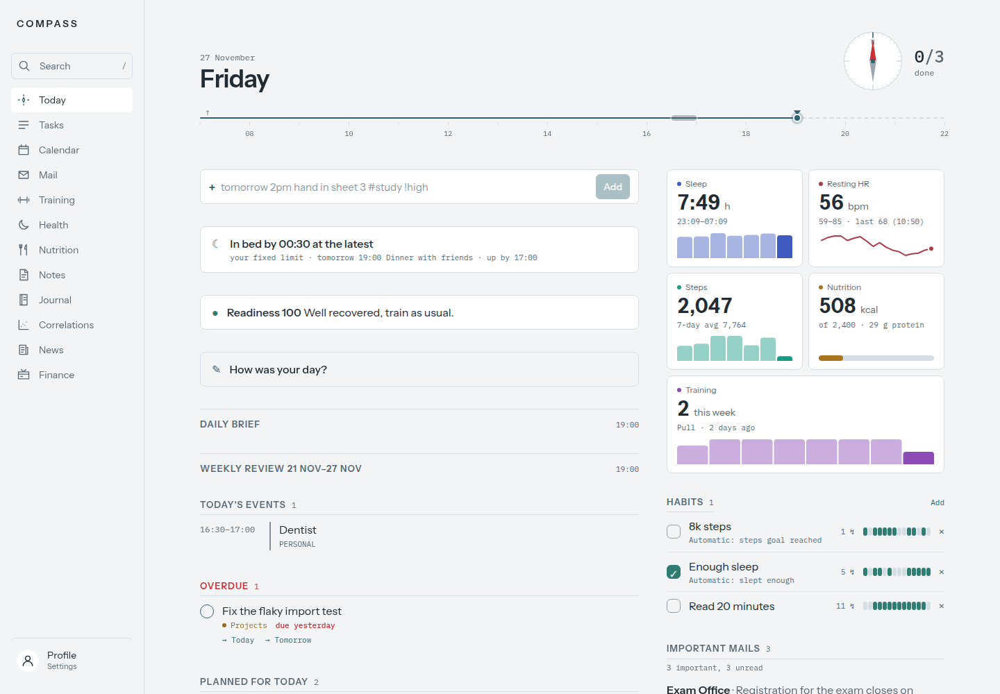
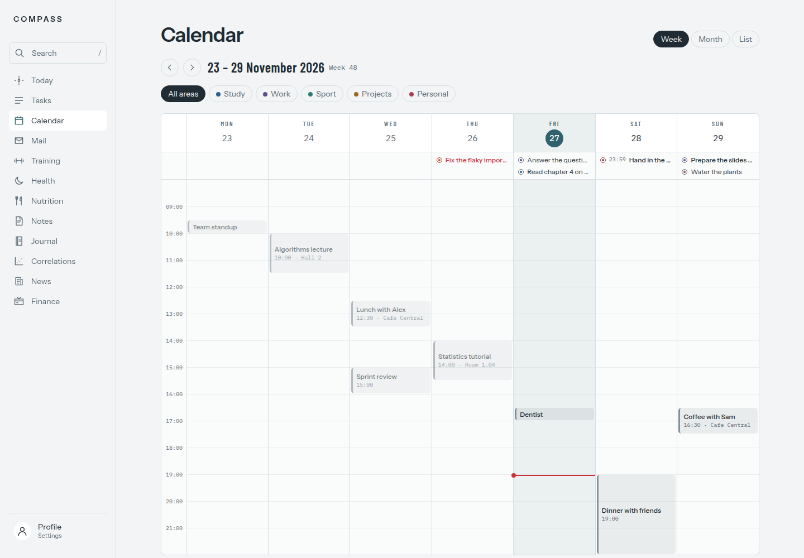
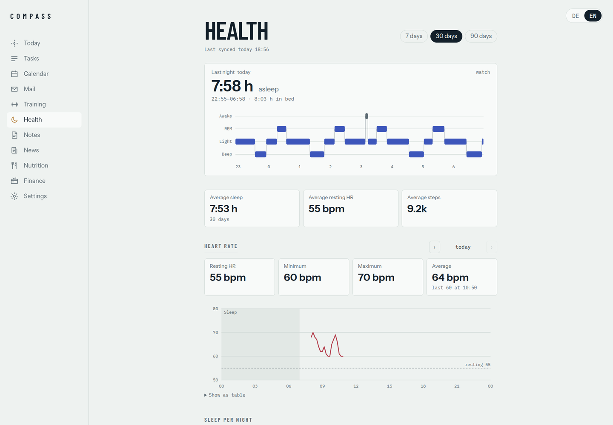
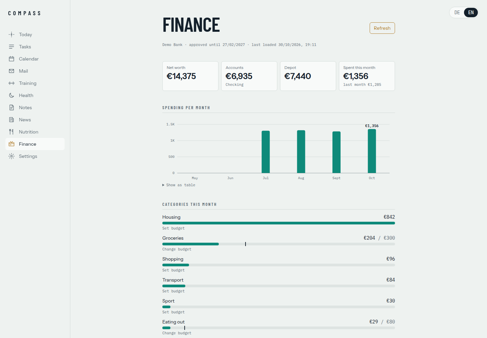

# Compass

A self-hosted dashboard for one person: tasks and deadlines, calendars, training, sleep, nutrition,
body measurements, mail, news, notes and bank accounts, with its own MCP server so Claude can read and
maintain all of it.

Compass is built for **one person per instance**: there is one login and no user management. It grew
out of its author's own setup, a German university with ILIAS, a watch and a few phone apps. Everything
except tasks, calendars and notes is optional and stays off until you configure it.

| | |
|---|---|
|  |  |
|  |  |

The screenshots show made-up data.

## Features

- **Tasks:** one-line quick add in German or English (dates, planned days, times, areas, priorities,
  recurrence), list and board view, areas and tags.
- **Calendar:** read-only ICS feeds (Google, Outlook, university calendars) in a week, month and agenda
  view. Deadlines from a learning platform's calendar become tasks.
- **Today:** events, due and planned tasks, important mails, the daily brief and live health tiles.
- **Notes:** a small knowledge base with tags and full text search; links and text can be shared into it
  from the phone.
- **Health:** sleep with stages, sleep rhythm, resting heart rate, steps and zone 2 minutes from Health
  Connect, plus the latest bedtime before the next day's first appointment.
- **Training:** strength training log with double progression, imports from Gym Day, Strong and Hevy,
  volume and progression per exercise.
- **Nutrition and body:** meals from any app that writes to Health Connect, a MyFitnessPal export for
  the past, goals, weight and waist trends, and a weekly review with a calorie recommendation by fixed rules.
- **Mail:** read-only IMAP for any number of accounts, triaged by Claude Haiku or a local Ollama model.
- **News:** RSS feeds ranked by an interest profile you train with thumbs up and down.
- **Finance:** bank accounts through Enable Banking, categories, budgets and recurring payments. Only
  banks in the EU and EEA, see the [note below](#finance).
- **Push notifications** to the installed PWA: bedtime, deadlines, resting heart rate, bank access.
- **MCP server** for Claude with OAuth: Claude can read everything above, plan your week and write
  briefs that show up on the dashboard.

## Integrations

| Integration | Needs | Off when |
|---|---|---|
| Calendars | ICS links (`CALENDAR_ICS_FEEDS`, `ILIAS_ICS_URL`) | no links set |
| Health, sleep, nutrition | Android only: the bridge app (`android/`) and `HEALTHCONNECT_TOKEN` | no token set |
| Training import | a CSV export of Gym Day, Strong or Hevy, uploaded or shared from the phone | not used |
| Mail | IMAP accounts (`MAIL_ACCOUNTS`); `ANTHROPIC_API_KEY` or a local Ollama for summaries | no account set |
| News | RSS feeds (`NEWS_FEEDS`, a small default list otherwise) | `NEWS_FEEDS` empty |
| Finance | a bank in the EU or EEA and an Enable Banking application ([docs/finance.md](docs/finance.md)) | no app id set |
| Push | a VAPID key pair (`make vapid-keys`) | no keys set |
| Claude | the MCP server, see [docs/deploy.md](docs/deploy.md); routines in [docs/routines.md](docs/routines.md) | not connected |

## Quick add

Tasks can be captured in one line. German and English keywords both work:

```
morgen 14 Uhr Blatt 3 abgeben #uni !hoch
tomorrow 2pm hand in sheet 3 #uni !high
Bericht schreiben @montag bis 30.10. #work
Müll rausbringen jeden Montag #personal
```

| Syntax | Meaning |
|---|---|
| `heute`/`today`, `morgen`/`tomorrow`, `freitag`/`friday`, `nächste woche`/`next week`, `in 3 tagen`/`in 3 days`, `12.11.`, `12. november`, `nov 12` | due date (deadline), optionally after `bis`/`am`/`by`/`on`/`due` |
| `@morgen`, `@friday`, … | planned day instead of the deadline |
| `14 Uhr`, `14:30`, `um 9`, `2pm`, `at 9` | due time (today if no date is given) |
| `#uni` | area if it exists, otherwise a tag |
| `!`, `!!`, `!!!`, `!hoch`/`!high`, `!dringend`/`!urgent`, `!niedrig`/`!low` | priority |
| `täglich`/`daily`, `werktags`/`weekdays`, `jeden Montag`/`every monday`, `alle 2 wochen`/`every 2 weeks`, `monatlich`/`monthly` | recurrence |

The interface is available in German and English (switch in the navigation). Texts the server writes itself (push notifications, the weekly review, mail summaries, MCP prompts) follow `COMPASS_LANGUAGE` (`en` or `de`). On Android, links and text can be shared into Compass from any app once the PWA is installed.

## Structure

| Directory | Contents |
|---|---|
| `backend/` | FastAPI API, worker (APScheduler) and MCP server for Claude. Python 3.12, uv, SQLAlchemy 2, Alembic |
| `frontend/` | React + TypeScript + Vite, served from the Caddy image |
| `android/` | Health Connect bridge app (Kotlin), pushes sleep and health data to the API |
| `infra/` | Docker Compose, Caddyfile |
| `data/` | Local raw data exports, not committed |

## Setup

The smallest setup (tasks, calendars, notes) needs Docker and three values in `.env`:

```bash
cp .env.example .env
# POSTGRES_PASSWORD:       any long random string
# COMPASS_BASIC_AUTH_USER: your login name
# COMPASS_BASIC_AUTH_HASH: output of `make password-hash`
make up                 # build and start everything in Docker
```

The app is then available at http://localhost:8080, the API docs at http://localhost:8080/api/docs.
On the first start, a short welcome page lets you adjust the areas and shows which sources are set up.
Add calendars and the other integrations in `.env` when you want them; `make up` again applies them.

## Development

```bash
make db      # Postgres only, exposed on localhost
make api     # API with reload on :8000 (runs migrations first)
make web     # Vite dev server on :5173, proxies /api to :8000
make mcp     # MCP server with reload on :8001
make test    # backend tests
make lint    # ruff + oxlint
make migration m="description"   # new Alembic migration
```

Requirements: Docker, [uv](https://docs.astral.sh/uv/), Node 20+ and pnpm.

## Calendars and deadlines

The worker fetches ICS calendars every 30 minutes (`CALENDAR_ICS_FEEDS`, `ILIAS_ICS_URL` in `.env`) and
mirrors their events for the Today page and the Calendar tab.

Learning platforms put assignment deadlines into their calendar. Those entries become tasks instead of
events: for ILIAS by the suffix "(Abgabetermin)" or "(Deadline)", for any other feed by a pattern on
the title in `CALENDAR_DEADLINES` (see [docs/deploy.md](docs/deploy.md)). A sync never duplicates them,
only changes title and deadline (area, priority, planned day and status stay yours), and cancels a
deadline that disappears instead of deleting it.

## Training

Log a session in the Training tab, or import the CSV export of Gym Day (`daily_strength.csv`), Strong or
Hevy, uploaded there or shared from the phone (the installed PWA is a share target for CSV files). The
format is recognised by its columns, and importing the same or an overlapping export again changes
nothing. Warm-up sets are left out. Another app is one small parser in `app/ingestion/workouts.py`.

The tab shows volume per week, the push/pull/legs split and the progression per exercise (estimated 1RM,
top weight, reps). Exercises renamed in the app can be merged so their progression continues in one line.

## Sleep and health

Sleep, steps, heart rate and workouts come from any watch or app that writes to Health Connect. Health
Connect only lives on Android phones, so a small Android app (`android/`, see its README) pushes the changes every
hour to `/api/ingest/healthconnect`, protected by its own token (`HEALTHCONNECT_TOKEN`) instead of the
dashboard login. Every record is stored as it arrived; derived from it are sleep sessions with stages
(a night counts for the day of waking up), heart rate samples and daily metrics. When two apps write the
same steps or sleep, a day takes the source with the larger total instead of adding them up.

The Sleep tab shows last night with its stages, sleep per night, resting heart rate, steps and workouts
outside the training log. Gym Day writes its sessions (without sets) to Health Connect as well;
Compass matches them with the sessions from the CSV export to fill in the duration in the Training tab.
A session that is only in Health Connect (no export, e.g. without Gym Day Premium) still shows up there,
with name, duration and split but without sets; a later export with its sets takes its place.
Nutrition and weight from Health Connect feed the Nutrition tab (below).

The latest bedtime and zone 2 use `WAKE_BUFFER_MINUTES`, `SLEEP_NEED_MINUTES`, `FALL_ASLEEP_MINUTES`,
`ZONE2_MIN_PERCENT` and `ZONE2_MAX_PERCENT`. Set your maximum heart rate as the goal `hr_max` (through
Claude with `set_nutrition_goal`); without it Compass assumes 190.

## Nutrition

Nutrition apps such as MyFitnessPal write every meal to Health Connect, so meals arrive with the bridge
app like sleep does. Compass sums them per day and meal (breakfast, lunch, dinner, snacks). If two apps write nutrition for
the same day, the one with more calories counts instead of both. The MyFitnessPal data export (the zip
it mails, or its CSV files) fills in the past: upload it in the Nutrition tab or share it from the phone.
Importing it again changes nothing, and for days that also have Health Connect data, those win. Days
without entries were not logged and stay empty in the charts, never 0 kcal. The export's weight file
fills the weight history; new weights come from Health Connect.

Daily goals for calories and protein apply from the day they are set, so earlier days keep the goal
they had. The Nutrition tab shows today against the goals, calories and protein per day, average
macros and the full weight history.

## Mail

The worker reads the inboxes of the accounts in `MAIL_ACCOUNTS` over IMAP, strictly read-only: nothing is marked as read, moved or deleted, and the mail text is never stored. Every mail gets
a priority from its headers at once (mailing lists and no-reply senders are unimportant, deadline words
in the subject important). A model then adds priority, whether something is to do, a short summary and a
suggested task. You choose per account who does that: Claude Haiku on the server, a local Ollama model
on a machine of yours for mails with data of third parties (`app/mail/local_triage.py`; that machine
reads the text itself and sends only the result), or nobody, the default. The Mail tab sorts by importance, turns a mail into a
task with one click and hides mails from the list; the Today page shows the important ones.

Mail content is untrusted: the model only returns fixed fields, links are stripped, and mails that try to
instruct an AI are flagged by a pattern check and never ranked below normal. The MCP tool marks every
field as external content.

For reading mails in Claude Code there is a separate read-only mail MCP (`app/mail/mcp_readonly.py`) for
all accounts in the `.env`: list folders, list and search mails, read one mail. It cannot send, move, flag
or delete; read mails stay unread. With it, the Compass prompt `sort_mails` lets Claude summarise new mails
on demand (`mails_to_triage`, `save_mail_triage`) without an API key:

```bash
claude mcp add --scope user compass-mail -- uv --directory "$PWD/backend" run python -m app.mail.mcp_readonly
```

## Finance

> **EU and EEA only.** Compass connects to banks through [Enable Banking](https://enablebanking.com), a
> PSD2 account information service, so it only reaches banks in the EU and EEA. Elsewhere the Finance
> tab stays usable for the depot value, but it gets no transactions. Another provider would need a new
> client next to `app/services/enablebanking.py`.

Setup, categories and the merchant rules are in [docs/finance.md](docs/finance.md). Amounts use the
currency of your bank account, and totals assume that all accounts share one.

## MCP server

Claude connects to Compass through its own MCP server (`app/mcp`), protected by OAuth with a
built-in login.

| Area | Tools |
|---|---|
| Tasks | `get_today`, `get_deadlines`, `list_tasks`, `get_task`, `list_areas`, `add_task`, `quick_add`, `update_task`, `complete_task` |
| Calendar | `get_calendar` |
| Notes | `search_notes`, `get_note`, `get_context`, `add_note`, `append_note` |
| Training | `training_summary`, `exercise_progress`, `progression_suggestions` |
| Health and body | `sleep_summary`, `nutrition_summary`, `set_nutrition_goal`, `body_trend`, `log_body_metric`, `weekly_review` |
| Mail | `list_important_mails`, `mails_to_triage`, `save_mail_triage` |
| News | `get_news_digest`, `feedback_news` |
| Finance | `finance_summary`, `list_transactions`, `categorize_transactions`, `set_budget`, `log_depot_value` |
| Dashboard | `save_brief`, `get_brief`, `send_notification` |

Prompts: `daily_brief`, `news_report`, `sort_mails`, `weekly_review`.

There is no delete tool, cancelling a task is the undo, and every write is recorded in an audit log.

## Deployment

See [docs/deploy.md](docs/deploy.md): server setup behind a reverse proxy and a VPN, login, MCP and backups.

## Contributing

Bug reports, ideas and pull requests are welcome, see [CONTRIBUTING.md](CONTRIBUTING.md).

## License

[MIT](LICENSE)
